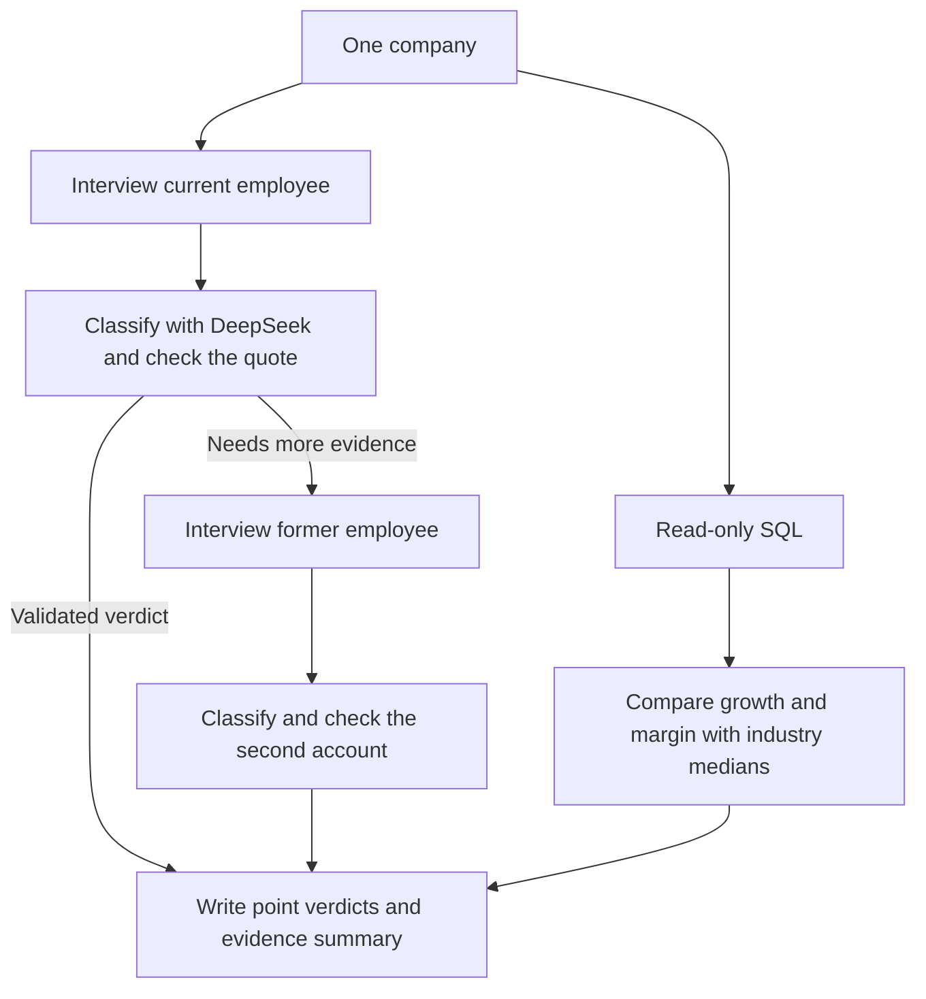

# FTEC5660 Homework 3 · Fisher Investment Agent

## Homework 3 solution

This agent evaluates fictional companies on three questions from Part One, Chapter 3 of Philip Fisher's *Common Stocks and Uncommon Profits*. It checks sales growth, operating profitability, and employee relations using the evidence provided by the course tools. Each company receives a point-by-point verdict and a short evidence summary.

### Decision rules and evidence

#### Point 1 · Market potential for sales growth

Recent growth offers a measurable signal of demand, and peer performance gives it industry context. Sum `orders.amount` separately for FY2023 and FY2025. **PASS** when the resulting two-year growth rate is strictly above `industry_medians.revenue_growth_2y_pct` for the company's own industry.

```text
Two-year growth (%) = (FY2025 revenue / FY2023 revenue − 1) × 100
```

A valid rate at or below the median is **FAIL**. The calculation uses two complete calendar years and requires a positive FY2023 baseline.

#### Point 5 · Worthwhile profit margin

Operating margin asks how much of each sales dollar remains after operating costs. **PASS** when the FY2025 operating margin is strictly above `industry_medians.operating_margin_pct` for the same industry.

```text
FY2025 operating margin (%) =
  (FY2025 revenue − cost of sales − selling and admin − R&D) / FY2025 revenue × 100
```

The agent sums order revenue and monthly expenses separately so joining the data cannot multiply the totals. A valid margin at or below the median is **FAIL**. The calculation requires positive FY2025 revenue and one complete cost record for each of the twelve months.

#### Point 7 · Labor and personnel relations

Employee interviews contain first-hand accounts of staff concerns that the financial records cannot show. The agent asks a current employee about `working_conditions` and turns to a former employee when it cannot validate a verdict from the first account.

| Outcome | Interview evidence |
| --- | --- |
| **PASS** | Specific signs of a healthy employee-management relationship, such as fair treatment, low turnover, good morale, or management taking staff concerns seriously, with no material problem reported. |
| **FAIL** | A material problem, such as sustained high turnover, poor morale, unfair treatment, labor conflict, or serious staff concerns that management ignored. A concrete problem carries more weight than generic praise. |
| **Seek more evidence** | The employee cannot comment, gives too little detail, or the model's reply fails validation after retries. This triggers the second interview if available. |

### Agent design



- **Numeric evidence.** One SQL query aggregates order revenue and monthly expenses, joins the industry benchmarks, and makes each comparison before rounding. The summary shows both the company's measured value and the corresponding median.
- **Interview evidence.** LangChain calls `deepseek-v4-flash` with the employee transcript. The model supplies a structured verdict and a supporting verbatim excerpt. Python checks the label and matches the excerpt against the source transcript before including it in the summary.
- **Failure handling.** The agent handles at most four companies concurrently. Each model request has a 30-second timeout, with at most two attempts per interview. When a verified judgment remains unavailable, the affected point is reported as missing and the other available verdicts are preserved.

The company tools supply all decision evidence. The provided runner compares the resulting judgments with the public labels after analysis.

### Worked example · Falcrest Technologies

| Point | Company evidence | Decision |
| --- | --- | --- |
| **1** | Two-year sales growth was **26.92%** against an industry median of **21.70%**. | **PASS** |
| **5** | FY2025 operating margin was **6.26%** against an industry median of **9.40%**. | **FAIL** |
| **7** | A current employee reported low morale and a strike threat over pay. | **FAIL** |

### Reproduce the public benchmark

Use Python 3.10 or later and run the following from the repository root.

```bash
python3 -m venv .venv
source .venv/bin/activate
python -m pip install -r requirements.txt
```

Set `DEEPSEEK_API_KEY` in the environment or put a `DEEPSEEK_API_KEY=...` entry in the local, gitignored `.env` file. The live interview path uses a DeepSeek API key. Obtain one from the [DeepSeek platform](https://platform.deepseek.com).

```bash
python hw3.py --data-folder public_test
```

The run writes `results.csv`. Read `points` and `summary` to audit a company's verdicts, `points_correct` and `point_errors` to compare them with the public labels, and `interviews_used` to check tool use.

Without a key, the SQL path still runs and the CSV records Point 7 as missing. For API-free regression checks, run the test suite with synthetic SQL data and model replies.

```bash
python -m unittest discover -s tests -v
```

### Public results

Three independent API runs on November 17, 2026 evaluated all 20 public companies. A separate clean-clone run installed dependencies in a new environment.

| Validation | Correct points | Balanced accuracy | Wall time |
| --- | ---: | ---: | ---: |
| Live run 1 | 60/60 | 100.0% | 5.51 s |
| Live run 2 | 60/60 | 100.0% | 5.18 s |
| Live run 3 | 60/60 | 100.0% | 4.99 s |
| Live run from a clean clone | 60/60 | 100.0% | 5.19 s |

Each of the three independent runs matched all **14 expected PASS** and **6 expected FAIL** decisions for each chosen point, giving 42 correct PASS and 18 correct FAIL judgments. There were no public disagreements to explain. Each of those runs produced 20 summaries and used one interview per company.

The grader defines balanced accuracy as the mean of recall for true PASS and recall for true FAIL. An all-PASS baseline would get 42/60 decisions correct and score 50% balanced accuracy.

I also ran a separate live check on four synthetic employee accounts covering a positive account, indirect criticism, praise alongside a material complaint, and insufficient evidence.

### Offline regression checks

- **Public replay.** I fed the recorded interview classifications back through the official runner. The latest implementation reproduced all 20 CSV rows and all 60 verdicts.
- **Missing credentials.** The CLI produced all 20 rows with 40/40 correct financial verdicts. It marked Point 7 missing and skipped the interviews.
- **Unit tests.** Eight cases cover financial thresholds, rounding, missing or duplicate cost data, a zero revenue baseline, and the interview path under normal and failure conditions.

Private-set performance remains unmeasured.

### Evidence limits

Two years of sales establish historical performance over a defined period. Future market potential depends on conditions beyond that window. The relative margin rule measures performance against peers in the same industry. An exact interview quote establishes what the transcript contains. Whether the excerpt supports the verdict still depends on its context.

### Task 2 reflection

[Read the reflection on AI sycophancy and AI psychosis](reflection.md).

## Course starter reference

The table schemas, tool specifications, and general assignment guidance below are reproduced from the [course starter repository](https://github.com/BINH2702/FTEC5660-HW3).

<details>
<summary>Open the original starter guidance</summary>

Build a LangChain agent that researches a company with tools and applies the
framework from Philip Fisher's *Common Stocks and Uncommon Profits* (Part One,
Chapter 3 "What to buy: the fifteen points to look for in a common stock", and
Chapter 4 "What to buy: applying this to your own needs"). You choose 3 of
Fisher's 15 points and decide yourself what PASS means for each. For every
company your agent gives a PASS/FAIL verdict on your 3 points and a short
summary.

The companies are fictional, so the model cannot answer from memory. Unlike a
pile of reports, the evidence is spread over three sources, and your agent has
to go and get it with tools, the way Fisher's "scuttlebutt" method sends an
investor to talk to customers, competitors, suppliers and staff.

### Data and tools

`public_test/` has one folder per company. Your code receives four tools per
company (built by the provided code in `hw3.py`):

| Tool | What it gives you |
| --- | --- |
| `list_documents()` | the company's six documents and their dates |
| `read_document(name)` | one document: the 2025 letter to shareholders, four earnings calls (Q3 2025 to Q2 2026) and a news file (July 2025 to July 2026) |
| `sql_query(query)` | one read-only SQLite query on the company's database; at most 50 rows come back, so use `SUM`, `GROUP BY` and `WHERE` |
| `interview(role, topic)` | what one person says about the company; at most **10 interviews per company** |

The documents are what management says. Management's own claims (such as "we
have never cut research" or "our people are our greatest strength") are not
evidence on their own: check them against the database and the interviews.

**Database tables** (amounts in USD thousands; dates `YYYY-MM-DD`, months
`YYYY-MM`, quarters like `2025Q3`; the fiscal year is the calendar year):

| Table | Columns |
| --- | --- |
| `company` | name, industry |
| `industry_medians` | industry, revenue_growth_2y_pct, new_product_share_pct, new_product_sales_per_rd, operating_margin_pct (one row per industry; use the row for the company's own industry) |
| `orders` | order_id, order_date, product, customer, amount, note (about 3,000 to 4,000 orders from January 2023 to June 2026; revenue is the sum of order amounts) |
| `products` | product, launch_date |
| `monthly_costs` | month, cost_of_sales, selling_admin, research_development |
| `quarterly_cash` | quarter, operating_cash_flow, capex, cash_end |
| `capex_plan` | year, planned_capex (2026 to 2028) |
| `returns` | month, units_shipped, units_returned |
| `insider_trades` | trade_date, person, title, side (`buy` or `sell`), shares, price |

**Terms used in the data.**

| Term | Meaning |
| --- | --- |
| FY2025 | Fiscal year 2025. Here the fiscal year is the calendar year, so FY2025 is January to December 2025. |
| Quarter | Three months of the year: Q1 is January to March, Q2 April to June, Q3 July to September and Q4 October to December. The database writes `2025Q3`; the documents write "third quarter 2025". |
| Amounts | The database is in **USD thousands** (676,100 means US$676.1 million). The documents use USD millions. |
| Revenue | Money from sales: the sum of `amount` in `orders`. |
| Cost of sales | The cost of making the products that were sold. |
| Selling and admin | The cost of selling and of running the company (sales staff, offices, management). |
| R&D | Research and development spending, mainly on new products. |
| Operating margin | Operating profit as a share of revenue: (revenue − cost of sales − selling and admin − R&D) ÷ revenue. |
| Operating cash flow | Cash that the day-to-day business brings in during a quarter. |
| Cash at the end of a quarter | The cash the company holds on the last day of that quarter (`cash_end`). |
| Capex | Capital expenditure: spending on factories, machines and other long-term assets. `capex_plan` holds the planned capex for 2026 to 2028. |
| Return rate | Units returned ÷ units shipped, from the `returns` table. |
| Industry median | The middle value for companies in the same industry, from `industry_medians`. |
| Insider | A director or senior manager of the company. `insider_trades` lists the shares they bought (`buy`) or sold (`sell`). |
| Earnings call | A meeting each quarter where management presents the quarter's results to investors. Each call quotes that quarter's revenue. |

**Interviews.** Roles: `customer`, `current_employee`, `former_employee`,
`competitor`, `supplier`. Topics: `sales_team`, `working_conditions`,
`top_management`, `decision_making`, `competitive_edge`. Only some people know
about each topic; the others say they can't comment, and that answer still
uses up one interview.

| Topic | Who knows about it |
| --- | --- |
| `sales_team` | customer, competitor |
| `working_conditions` | current_employee, former_employee |
| `top_management` | former_employee, supplier |
| `decision_making` | supplier, customer |
| `competitive_edge` | competitor, customer |

People who know about a topic always agree with each other, so one good answer
is enough.

### Choose your 3 points and your rules

Pick any 3 of Fisher's 15 points and write them in `CHOSEN_POINTS` near the
top of `hw3.py`, e.g. `CHOSEN_POINTS = [1, 7, 15]`. The full questions are in
`FISHER_POINTS` in `hw3.py` and in the book.

| # | Fisher's point | Where the evidence is |
| --- | --- | --- |
| 1 | Market potential for sales growth | database |
| 2 | New products as current lines mature | database |
| 3 | Effective research and development | database |
| 4 | Above-average sales organization | interviews (`sales_team`) |
| 5 | Worthwhile profit margin | database |
| 6 | Maintaining or improving margins | database |
| 7 | Labour and personnel relations | interviews (`working_conditions`) |
| 8 | Executive relations | interviews (`top_management`) |
| 9 | Depth of management | interviews (`decision_making`) |
| 10 | Cost analysis and accounting controls | earnings calls, checked against the database |
| 11 | Advantage over competitors | interviews (`competitive_edge`) |
| 12 | Long-range outlook on profits | database |
| 13 | Growth without dilutive equity financing | database |
| 14 | Management talks freely about troubles | earnings calls, checked against the database |
| 15 | Management of unquestionable integrity | news file, checked against the database |

For each of your points, **you design the rule**: which evidence to use, what
to compute or whom to ask, and where the line between PASS and FAIL lies. PASS
means the company looks favourable on that point, as Fisher would see it.

We grade your verdicts against our own answer key. It uses one fixed rule per
point, which we do not publish, and the data never puts a company close to
the line of that rule, so a sensible reading of Fisher usually gives the same
answer. **Test your rules on the public answers**:
`public_test/ground_truth.json` gives the expected verdict on all 15 points
for each of the 20 public companies, and every point fails in 6 of them. If
your rule disagrees with the public answers, rethink it.

**Tip: calculate with tools, not in your head.** Do every sum, ratio and
comparison in SQL or Python, including the number of days between two dates
(SQLite's `julianday()` gives a date as a number of days).

### Student task

Fill in the three places in `hw3.py` marked `### YOUR CODE HERE`. You may add
imports, constants and helper functions above them, but do not change the
provided code below them:

- `CHOSEN_POINTS` lists your 3 points.
- `build_agent()` creates your model and anything else you need once.
- `analyze_companies(agent, companies)` receives
  `{company_folder: [list_documents, read_document, sql_query, interview]}`
  and returns, for every company,
  `{"points": {1: "PASS", 7: "FAIL", 15: "PASS"}, "summary": "..."}` (here with
  `CHOSEN_POINTS = [1, 7, 15]`).

Use the course techniques that fit your points: tool use for the database and
the interviews, planning which interviews to spend, routing each point to the
right source, prompt chaining, parallel calls, reflection to check your
answers, or a combination. Your code must read company data **only through
the four tools**; do not open `company.db` or `interviews.dat` yourself. Do
not hard-code folder names, company names or the public answers.

### Setup and public test

```bash
python3 -m venv .venv
source .venv/bin/activate
pip install -r requirements.txt
echo "DEEPSEEK_API_KEY=your_key_here" > .env
python3 hw3.py --data-folder public_test
```

Use your own DeepSeek API key (from https://platform.deepseek.com). The
required model is `deepseek-v4-flash`. We grade with our own key, so never put
a key in your code; `.env` must stay out of git.

The program creates `results.csv` with the columns `company`, `points`,
`points_correct`, `point_errors`, `interviews_used` and `summary`, and prints
the point score on your 3 points (the percentage after "balanced"). The point
score is the average of two shares: the share of truly passing verdicts that
you marked PASS and the share of truly failing verdicts that you marked FAIL.
For example, 90% and 60% give (90% + 60%) / 2 = 75%, and marking every point
PASS gives (100% + 0%) / 2 = 50%. Once `CHOSEN_POINTS` is set, the starter
runs before you add any API code (it returns no verdicts, so it scores 0%).

`public_test/ground_truth.json` gives the expected verdicts on all 15 points
for each public company. Grading uses a private set of about 20 unseen
companies with the same tools and the same answer key rules, but different
names and wording, and scores your 3 points only.

</details>
